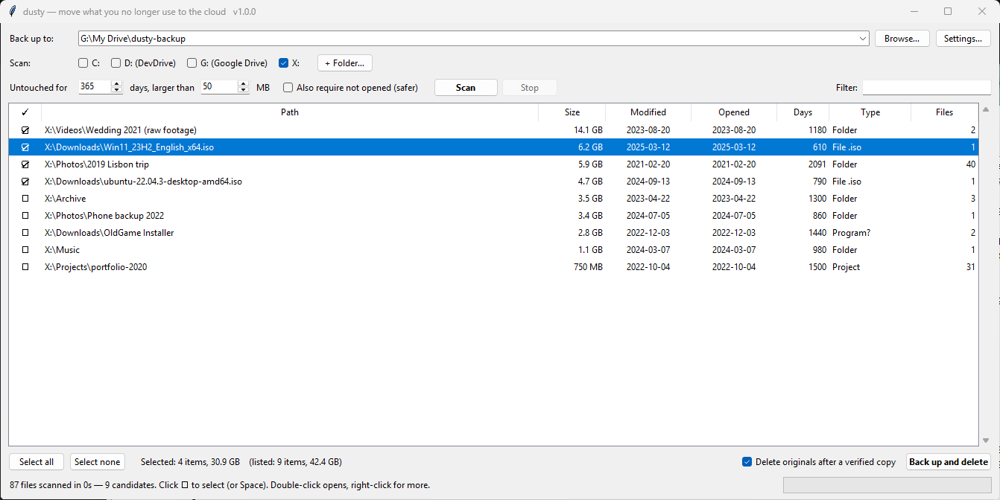

# dusty

**Find what has been gathering dust on your disks, back it up to cloud storage, free up space.**

dusty scans your drives for folders and files you have not touched in a long time. You tick the
ones you want gone, and it copies them to a backup folder, which can be Google Drive, OneDrive,
Dropbox, a NAS or a USB disk. It checks the copy and only then deletes the original.



[](https://github.com/bugraskl/dusty/actions/workflows/ci.yml)
· Python 3.9+ · no dependencies · Windows first, works on Linux and macOS · [Türkçe ↓](#türkçe)

## Features

- **Fast.** Folder sizes are counted in parallel. About 3 million files take under a minute on
  an SSD. Changing the thresholds afterwards is instant, with no rescan.
- **Shows whole folders.** If everything inside `Photos\2019 trip` is old, you get one row for
  `Photos\2019 trip`, not 400 rows of photos. If something inside is still in use, dusty looks
  one level deeper.
- **Projects stay whole.** A folder that contains code or a project marker (`.git`,
  `package.json`, `*.sln`, `*.py`…) is offered entirely or not at all, so nothing is pulled out of a
  repo you still use.
- **Leaves the system alone.** Windows, Program Files, AppData, dot-folders, OneDrive, hidden and
  system files, drive-root files and links are never listed.
- **Copy, check, then delete.** An item is deleted only after every file in it was copied and
  verified by size, or by SHA-256 if you prefer. If anything fails, the original stays where it
  is.
- **Keeps the original paths.** `D:\Projects\old` is backed up to `<backup>\D\Projects\old`, so
  you can always tell where something came from.
- **Can be resumed.** If you stop or the run is interrupted, the item in progress is not deleted.
  Running the same items again skips files that were already copied.
- **Logs every item.** `_dusty_log.csv` in the backup folder records each one.
- **Finds your cloud folders.** It suggests Google Drive (in any language), OneDrive, Dropbox,
  iCloud and others as the destination.
- **English and Turkish UI**, picked automatically from your system language.

## Install

```bash
pip install git+https://github.com/bugraskl/dusty
```

That gives you two commands:

| command     | what it does                                    |
|-------------|-------------------------------------------------|
| `dusty-gui` | opens the window (no console window on Windows) |
| `dusty`     | the same window, or `dusty scan` for a report   |

You can also run it without installing:

```bash
git clone https://github.com/bugraskl/dusty && cd dusty && python -m dusty
```

Tkinter ships with Python on Windows and macOS. On Debian/Ubuntu, run `sudo apt install python3-tk`.

## Using the window

1. **Back up to:** pick a destination. The list shows cloud folders found on this PC.
2. **Scan:** tick drives, or add folders with **+ Folder…**, then press **Scan**. Scanning only
   reads file metadata and never changes anything.
3. Set **Untouched for N days** and **larger than M MB**. The list updates as you type.
   Tick **Also require not opened** for a stricter check (see *Access time* below).
4. Tick rows by clicking ☐, or select several and press <kbd>Space</kbd>. Double-click a row to
   open its folder. Right-click a row to hide it permanently.
5. Press **Back up and delete**. To keep the originals, untick *Delete originals after a verified
   copy* first.

## Command line

```bash
dusty scan                                  # all local drives, settings from the config file
dusty scan --root D:\ --days 730 --min-mb 200
dusty scan --root ~/Downloads --format json > old.json
dusty scan --format csv --exclude "D:\Work" > report.csv
dusty gui --root E:\Archive --dest "G:\My Drive\dusty-backup" --scan
```

`dusty scan` is read-only. Moving files is only done from the window, where you can see exactly
what will happen.

## How candidates are chosen

```
D:\                      ← drive root: never offered, its files are never touched
├─ Windows, Program Files, $Recycle.Bin …            skipped (system)
├─ Users\me              ← profile: never offered as a whole
│  ├─ AppData, .ssh, .vscode, OneDrive …             skipped
│  └─ Downloads          ← looked into, because something in it is recent
│     ├─ old-installer\        all files > 365 days → ONE ROW
│     ├─ movie.mkv (3 GB)      old → ONE ROW
│     └─ today.pdf             recent → keeps Downloads from being one row
└─ Projects
   ├─ website-2019\  (.git)    project, all old → ONE ROW (never split)
   └─ current-app\   (main.py) project, recent → nothing offered from inside
```

- A folder counts as "untouched" when the **newest modification time of any file inside it** is
  older than the threshold. Empty folders use their own timestamp.
- Listing goes `max_depth` levels deep (4 by default, e.g. `C:\Users\me\Downloads\X`). Below that,
  folders are only summed up.
- Large loose files (≥ 1 MB, and above your size threshold) get their own row.
- Timestamps more than a day in the future are ignored, and unreadable folders count as "in use".

### Access time

Windows can record when a file was last opened, but whether it does depends on the system
(`fsutil behavior query disablelastaccess`). Copying or restoring files also resets it. That is
why the stricter "not opened" check is optional: it is safer, but it can hide everything if your
data was recently copied to a new disk.

## Settings

Change settings in the window under **Settings…**, or edit the JSON file directly:

- Windows: `%APPDATA%\dusty\config.json`
- Linux/macOS: `~/.config/dusty/config.json`
- or any path set in `DUSTY_CONFIG` / passed with `--config`

| key | default | meaning |
|---|---|---|
| `destination` | `""` | backup folder |
| `days`, `min_mb` | `365`, `50` | thresholds |
| `use_access_time` | `false` | also require "not opened since" |
| `delete_after_copy` | `true` | delete originals after a verified copy |
| `verify` | `"size"` | `"size"` or `"hash"` (SHA-256, slower) |
| `excludes` | `[]` | paths that are never touched, including everything inside |
| `max_depth` | `4` | deepest level offered as its own row |
| `workers` | `8` | scan threads |
| `language` | `"auto"` | `"auto"`, `"en"`, `"tr"` |
| `system_names`, `users_skip`, `profile_skip` | see [`config.py`](dusty/config.py) | folders that are skipped |
| `project_markers`, `code_extensions` | see [`config.py`](dusty/config.py) | what counts as a project |

Unknown keys are ignored, and values of the wrong type fall back to the default.

## Restoring

The backup mirrors the original paths, so restoring means copying a folder back:

```
G:\My Drive\dusty-backup\D\Projects\website-2019  →  D:\Projects\website-2019
```

`_dusty_log.csv` lists every item with its original and backup location.

## Good to know

- **Cloud apps cache on your system disk.** Google Drive for desktop and OneDrive write files to a
  local cache before uploading them. Moving 100 GB "to the cloud" can briefly use 100 GB on `C:`.
  dusty warns you when a selection gets close to that. Work in batches and let the upload finish
  in between.
- **Deletion is permanent.** Files are not moved to the Recycle Bin, because the point is to free
  space and the verified copy is your backup. Check that your cloud app has finished uploading
  before relying on it.
- **Links are safe.** Symlinks and junctions are never followed. Deleting a folder that contains
  one removes only the link, never its target.

## Development

```bash
pip install -e ".[test]"
pytest
```

The tests create real folders, files, junctions or symlinks, read-only files and paths longer than
260 characters in a temporary directory. CI runs them on Windows, Linux and macOS.

## License

[MIT](LICENSE)

---

## Türkçe

**dusty**, diskinizde uzun süredir dokunulmamış klasör ve dosyaları bulur. İşaretlediklerinizi
Google Drive, OneDrive, NAS ya da harici diske kopyalar, kopyayı doğrular ve ancak ondan sonra
orijinali siler.

- **Kurulum:** `pip install git+https://github.com/bugraskl/dusty`, ardından `dusty-gui`. Kurmadan
  denemek için: `python -m dusty`.
- **Arayüz dili** sistem dilinden seçilir (Türkçe/İngilizce). İsterseniz *Ayarlar…* içinden
  değiştirebilirsiniz.
- **Tarama** hiçbir şeyi değiştirmez. Eşikleri (gün / MB) değiştirdiğinizde liste anında güncellenir.
- **Projeler** (`.git`, `package.json`, kod dosyası olan klasörler) hiçbir zaman bölünmez.
- **Sistem klasörlerine dokunulmaz:** Windows, Program Files, AppData, `.` ile başlayan klasörler
  ve OneDrive listelenmez.
- **Kopyalamada hata olan öğe silinmez.** Yarıda kalan bir işlem yeniden başlatılabilir; daha önce
  kopyalanmış dosyalar atlanır.
- **Yedek, orijinal yolu korur** (`…\D\Projeler\eski`). Hangi öğenin nereye gittiği hedefteki
  `_dusty_log.csv` dosyasında yazar.
- **Dikkat:** Google Drive ve OneDrive dosyaları yüklemeden önce C: sürücüsünde önbelleğe alır.
  Büyük taşımaları parça parça yapın ve yüklemenin bitmesini bekleyin. Silme kalıcıdır, dosyalar
  Geri Dönüşüm Kutusu'na gitmez.
